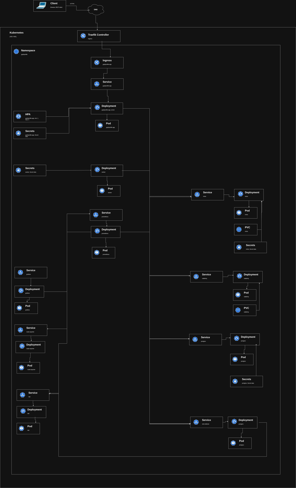

# GophProfile

GophProfile - сервис для хранения и предоставления пользовательских аватаров. Пользователь загружает фотографию один раз, после чего сторонние платформы могут получать её через REST API.

## Технологии

- **Backend:** Go
- **База данных:** PostgreSQL
- **Объектное хранилище:** MinIO (S3)
- **Очереди сообщений:** RabbitMQ
- **Оркестрация:** Docker, Kubernetes, Helm
- **Мониторинг:** Prometheus, Grafana
- **Логирование:** Loki
- **Телеметрия:** OpenTelemetry

## Архитектура

Приложение и инфраструктурные компоненты развёртываются в Kubernetes с использованием Helm.

Архитектурная диаграмма Kubernetes находится в директории [`docs/`](docs/).



## Документация API

Документация REST API, созданная с помощью Swagger, находится в директории [`docs/`](docs/).

## Запуск в кластере

Приложение настроено под запуск в кластере и упаковано в Helm. Для запуска достаточно сделать следующее:

Добавляем в `deployment/values-secret.yaml` секреты. Пример:

```yaml
secrets:
  rabbitmq:
    username: example
    password: example

  postgres:
    username: example
    password: example

  minio:
    username: example
    password: example
```

Устанавливаем все что связано с мониторингом

```bash
helm install monitoring prometheus-community/kube-prometheus-stack -n gophprofile -f monitoring-values.yaml
```

Собрать образ приложения и воркера

```bash
docker build -t gophprofile .
docker tag gophprofile gophprofile:1.0
```

Затем прокинуть образ в k8s

```bash
k3d image import gophprofile:1.0 -c local
```

Добавить домент в `/etc/hosts`

```text
127.0.0.1   gophprofile.loc
```

Затем запустить установку через helm

```bash
helm upgrade --install gophprofile . --namespace gophprofile -f values-secret.yaml --create-namespace
```